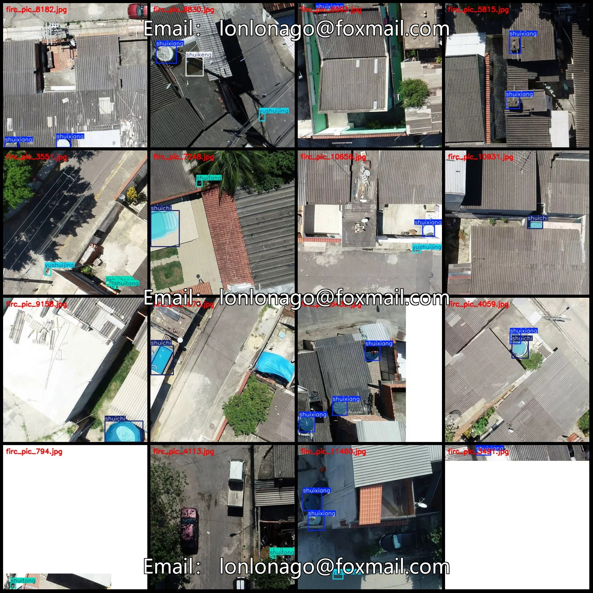
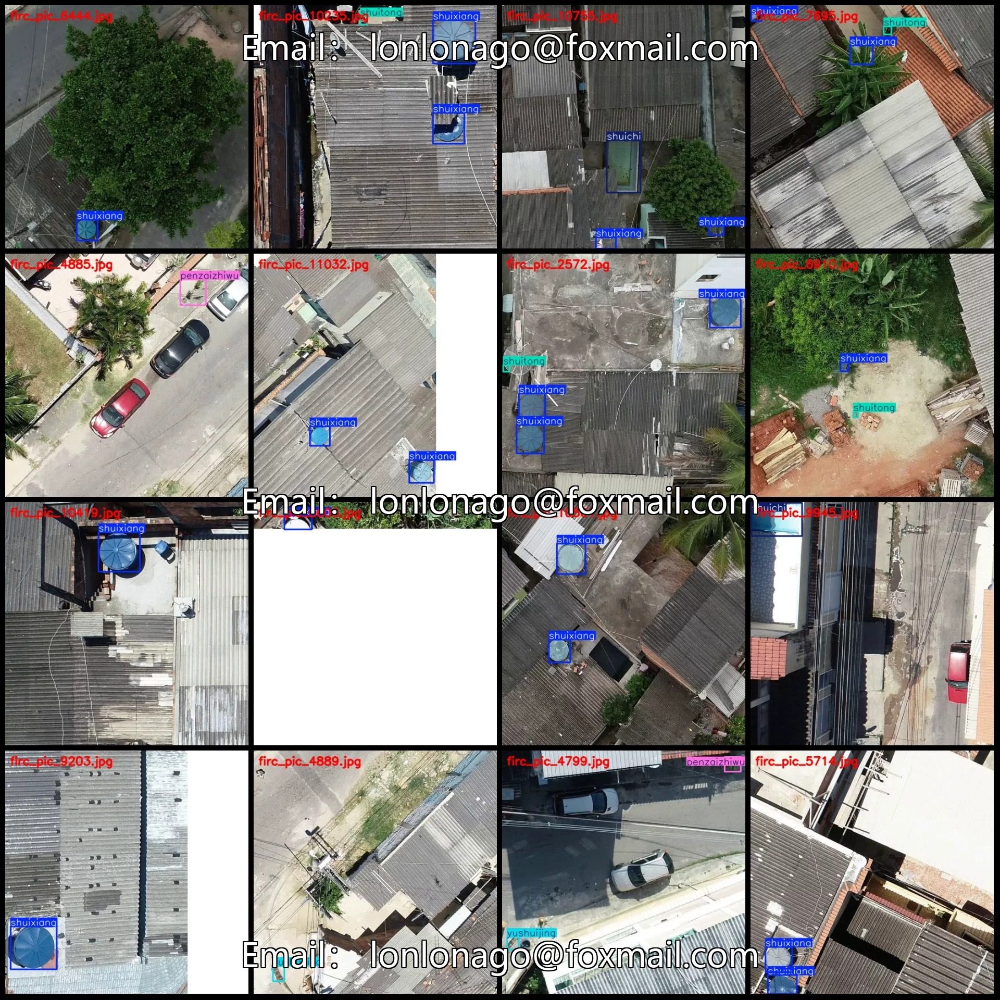
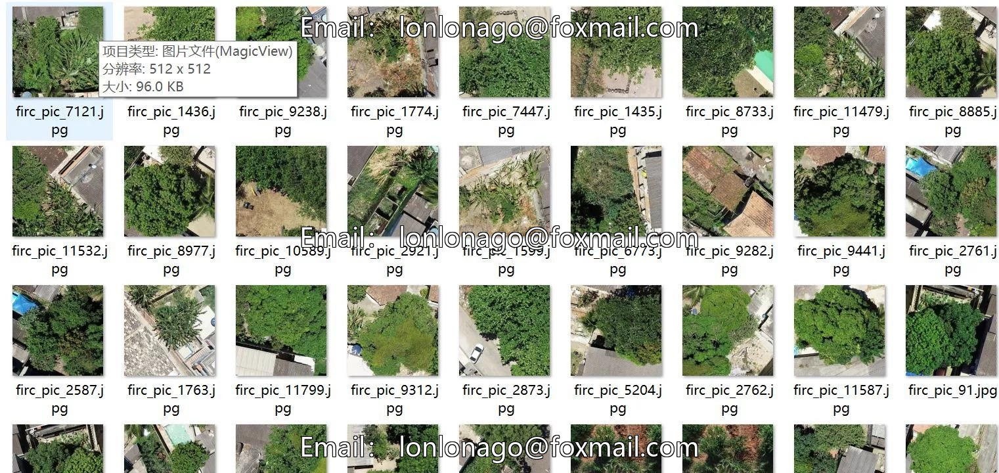
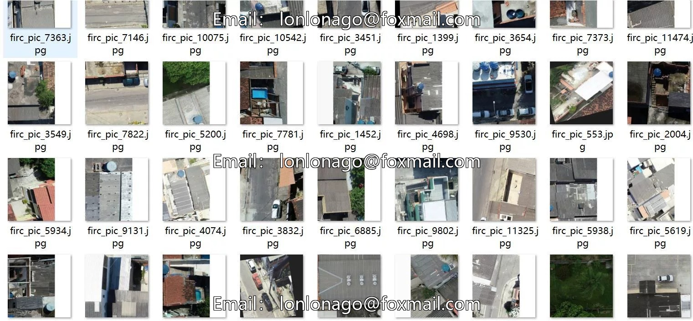

# Drone-view aerial photography roof clutter detection dataset VOC+YOLO format 1221

## Body

Drone-Viewpoint Aerial Photography Roof Debris Detection Dataset VOC+YOLO Format: 12,217 Images in 10 Categories
Warm Reminder: Due to the dataset's replicability, please confirm compliance with requirements before purchasing.
Dataset Format: Pascal VOC format + YOLO format (txt file without split path, only containing jpg images and corresponding VOC format xml files and yolo format txt files)
Number of Images (Total jpg files): 12,217
Number of Annotations (Total xml files): 12,217
Number of Annotations (Total txt files): 12,217
Number of Annotation Categories: 10

Label category names (Note that the order of categories in the Yolo format does not correspond to this, but is based on the classes.txt file in the labels folder): ["lajixiang", "luntai", "penzaizhiwu", "pingzi", "shuichi", "shuikeng", "shuitong", "shuixiang", "suliaodai", "yushuijing"]
1. Garbage bin
Number of boxes labeled in each category

lajixiang frame count = 349
Luntai Frames = 1956
penzaizhiwu Frames = 2602
Pingzi Frames = 380
Shuichi Frame Count = 3002
shuikeng frame count = 177
Shutong Frame Count = 3045
Shuixiang frame count = 11986
suliaodai frame count = 384
Yushuijing frame count = 2725
Total frame count: 26606
Number of images per category
lajixiang occupies = 317

Luntai occupies 705 images
Penzaizhiwu occupies 1129 images
Pingzi occupies 105 images
Shuichi occupies 2788 images
Shuikeng occupies 150 images
Shuitong occupies 2217 images
Shuixiang occupies 7432 images
Suliaodai occupies 274 images
Yushuijing occupies 2081 images
Image resolution: 512x512
Labeling tool used: labelImg
Labeling rules: Draw a rectangle around the category.

Important Notice: The dataset does not have separate training, validation, and test sets; you need to partition them yourself.
Special : This dataset does not guarantee the accuracy of the trained models or weight files.

## Images

## Payment

Here is a pay link on Stripe ( https://buy.stripe.com/3cs8yP7sY87d0vu9AB ). Please contact me lonlonago@foxmail.com after funding $89, and I will send you a complete data files , thank you!

